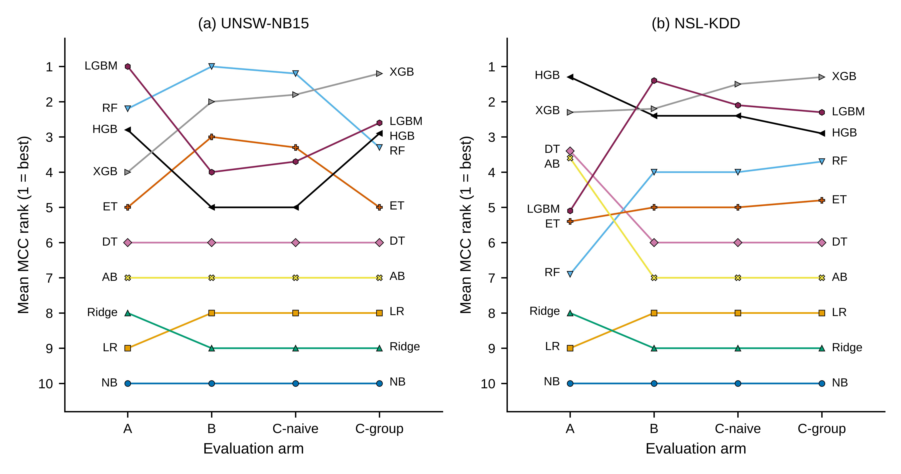
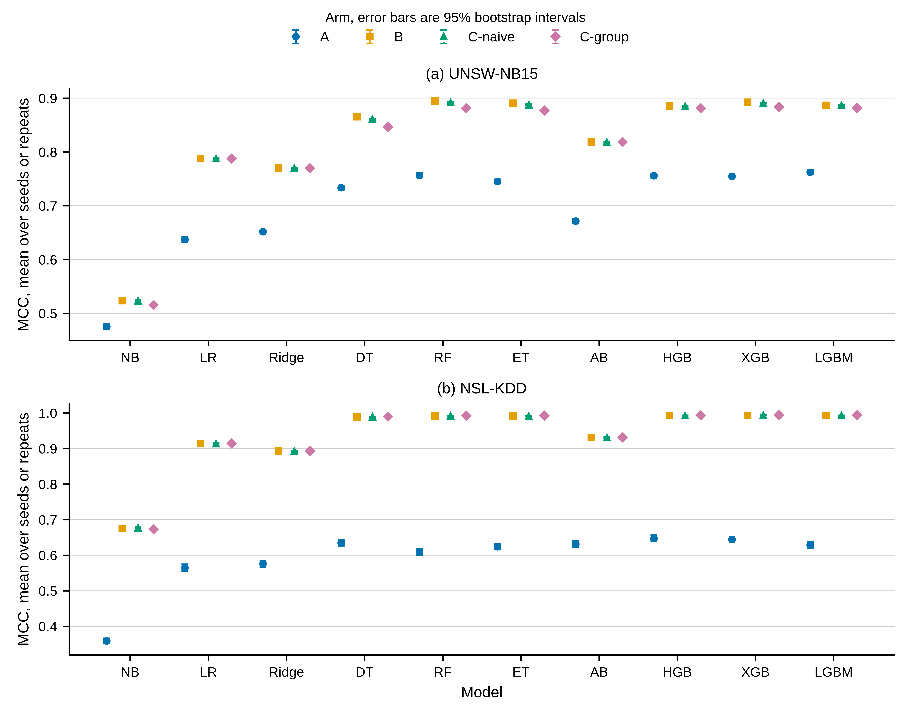
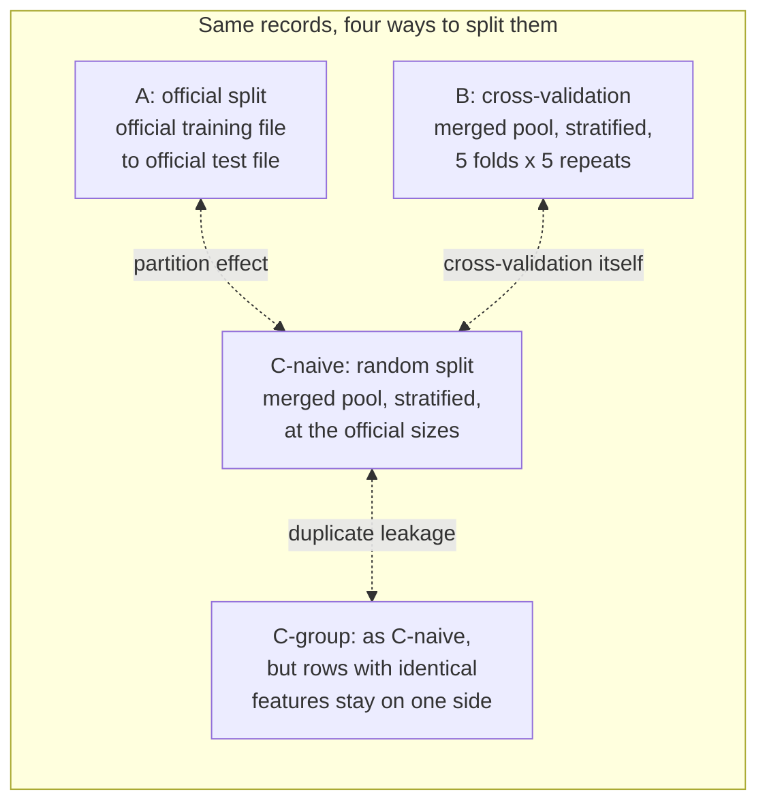

# Separating Partition, Leakage and Data Effects in Network Intrusion Detection Benchmarks

**A Size-Matched Control for Classifier Rank Stability**

Code, frozen results and verification files for my MSc thesis in Cyber Security at Daffodil International University, Bangladesh (October 2026). Supervisor: Prof. Dr. A.H.M Saifullah Sadi.

A journal article based on this work is in preparation.

## In short

Many intrusion detection studies train on the official training file of UNSW-NB15 or NSL-KDD and test on the official test file. A low score on that test file can be taken to mean that its attacks are harder to detect. This study asks how much of that difficulty comes from the attacks, and how much from the way the records were split between the two files.

The records were never changed. The same records were split in four ways, and everything else stayed fixed: ten untuned classifiers, the same preprocessing and the same seeds. The main control is a stratified random split of the merged files at exactly the official sizes. A change in the ranking of the models counted as real only if it was larger than the change that the seeds alone produce.

On UNSW-NB15, the official split made the task harder, and this extra difficulty came from the split itself, not from new kinds of attacks. The official split also changed which model ranked best. Duplicate records explained only a small part of the gap. On NSL-KDD, whose test file holds attacks that are missing from training, the effect was larger, as expected.

**Research question.** How much of the publisher-split difficulty of two widely used intrusion detection benchmarks comes from the partition itself, rather than from the attacks the partition contains?

## Main results

All values come from the frozen files in [`results/`](results/). Intervals are 95% percentile intervals from 2,000 bootstrap resamples of the evaluation rows. MCC is the Matthews correlation coefficient, the primary metric.

| Measure | UNSW-NB15 (test case) | NSL-KDD (positive control) |
|---|---|---|
| Mean MCC of the ten models, official split (arm A) | 0.6944 | 0.5919 |
| Mean MCC, random split at the official sizes (arm C-naive) | 0.8201 | 0.9364 |
| Partition effect: A minus C-naive, mean MCC [95% interval] | -0.1257 [-0.1288, -0.1224] | -0.3445 [-0.3516, -0.3370] |
| Rank agreement, A against C-naive (mean Kendall tau-b) | 0.7289 | 0.5333 |
| Seed noise floor: 5th percentile of tau-b inside C-naive | 0.9111 | 0.8667 |
| **H2:** the official split reorders the models more than the seeds do | **Met** | **Met** |
| Rank disagreement from cross-validation, d(B, C-naive) | 0.0222 | 0.0667 |
| Rank disagreement from the partition, d(A, C-naive) | 0.2711 | 0.4667 |
| **H3:** the ranking gap between the official split and cross-validation comes mainly from the partition | **Met** | **Met** |
| Duplicate leakage: C-naive minus C-group, mean MCC [95% interval] | 0.0058 [0.0040, 0.0075] | -0.0004 [-0.0014, 0.0006] |
| Top-ranked model in arms A / B / C-naive / C-group | LGBM / RF / RF / XGB | HGB / LGBM / XGB / XGB |

Here d = 1 - mean tau-b. The arms and the model names are described in [Study design](#study-design).

What the numbers show:

- **Every classifier scored lowest on the official split**, on both datasets. This holds for MCC, balanced accuracy, accuracy and macro-F1, against each of the other three arms.
- **On UNSW-NB15 the gap is large next to the gaps between models.** The partition effect is about seven times the MCC range of the top five models under the official split.
- **The extra errors on UNSW-NB15 are false alarms on normal traffic, not missed attacks.** Every attack category in the official test file also appears in training. For 9 of the 10 models, the false alarm rate on the official test file was 1.46 to 4.35 times as high as under the random split (C-naive).
- **On NSL-KDD the loss is mainly in detection.** 17 attack names in the official test file never appear in training. The mean detection rate was 0.6097 under the official split and 0.9424 under the random split.
- **Cross-validation itself adds almost nothing.** Cross-validation and a random split of the same records ranked the models almost the same way (mean tau-b 0.9778 on UNSW-NB15 and 0.9333 on NSL-KDD).
- **Duplicate leakage explains less than a twentieth of the UNSW-NB15 gap** (0.0058 of 0.1257). It still matters at the top: random forest ranked first at 8 of 10 C-naive seeds, and XGBoost at 8 of 10 C-group seeds, where exact-match leakage is removed.
- **The ranking a reader sees depends on the split.** The official UNSW-NB15 split puts LightGBM first. On NSL-KDD, the official split ranks a single decision tree above a random forest; random splits of the same records give the reverse order.
- **Duplicates in the official UNSW-NB15 files.** 74,072 of 175,341 training rows (42.24%) and 28,380 of 82,332 test rows (34.47%) repeat an earlier row of the same file (features plus label). 8,541 test rows (10.37%) have exactly the same features as a training row. A random split at the official sizes raises this share to 44.34% on average. On NSL-KDD the direction reverses: 2.95% under the official split and 0.84% under random splits.

**What this means in practice.** Results on the official UNSW-NB15 split and results from cross-validation or a random split of the merged files should not be compared directly. On these data they differ by about 0.13 in mean MCC and about 7 points of accuracy, and the ranking of the models changes.



*Figure F2. Mean MCC rank of each classifier in each arm (1 = best). Thesis Figure 4.*



*Figure F3. Mean MCC of each classifier in each arm. The error bars are 95% bootstrap intervals; most are smaller than the markers. Thesis Figure 2.*

The bootstrap distributions of rank agreement, drawn against the seed noise floor, are in [`F4_bootstrap_tau.pdf`](results/figures/F4_bootstrap_tau.pdf) (thesis Figure 3).

## Study design



The merged pool is the official training file and the official test file put together.

| Arm | Training side | Test side | Seeds | Fits per dataset |
|---|---|---|---|---|
| A, official split | official training file | official test file | 10; only model randomness varies | 100 |
| B, cross-validation | merged pool, stratified 5-fold, 5 repeats | out-of-fold predictions over the whole pool, one score per repeat | 5 repeats | 250 |
| C-naive, random split | stratified random draw from the merged pool, at the official training size | the rest of the pool, at the official test size | 10 | 100 |
| C-group, group-aware split | as C-naive, but all rows with identical features stay on the same side | as C-naive | 10 | 100 |

Each pair of arms differs in one thing:

| Contrast | Held fixed | What it isolates |
|---|---|---|
| A against C-naive | set sizes and mechanics (one fit, one test) | the partition effect |
| C-naive against C-group | sizes, mechanics and pool | exact-match duplicate leakage (moving whole groups also shifts the attack mix a little) |
| B against C-naive | the pool of records | cross-validation itself |
| A against B | nothing | both effects mixed, as when a study compares an official-split result with a cross-validation result |

**Datasets.** UNSW-NB15 is the test case, where the finding lives. NSL-KDD is the positive control: its official test file holds attacks that are missing from training, so a partition effect is expected there. If the method found no effect on NSL-KDD, the method would be at fault.

| | UNSW-NB15 | NSL-KDD |
|---|---|---|
| Official training file | 175,341 rows | 125,973 rows |
| Official test file | 82,332 rows | 22,544 rows |
| Merged pool | 257,673 rows | 148,517 rows |
| Attack share, training / test file | 68.06% / 55.06% | 46.54% / 56.92% |

**Held fixed in every arm:**

- **Ten classifiers, untuned, at fixed settings.** Three weak or linear models: Gaussian naive Bayes (M01, NB), logistic regression (M02, LR) and ridge (M03, Ridge). One decision tree (M04, DT). Two bagging ensembles: random forest (M05, RF) and extra trees (M06, ET). Four boosting ensembles: AdaBoost (M07, AB), histogram gradient boosting (M08, HGB), XGBoost (M09, XGB) and LightGBM (M10, LGBM). Exact settings are in [`T2_classifiers.csv`](results/tables/T2_classifiers.csv) and in `MODEL_SPEC` in [`src/experiment.py`](src/experiment.py).
- **Preprocessing fitted on the training side of each split only:** the rare-category threshold (0.1%), the one-hot encoder and the scaler. No resampling, no class weights, no feature selection and no tuning.
- **Seeds** 11, 22, 33, 44, 55, 66, 77, 88, 99 and 110; arm B uses the first five. 1,100 fits in total.
- **Metrics.** MCC is the primary ranking metric, declared in advance. Accuracy and macro-F1 are secondary. Balanced accuracy is reported beside MCC.
- **Statistics.** Rank agreement is Kendall's tau-b, averaged over all seed pairs of two arms. The noise floor is the tau-b between the seeds of one arm. Intervals come from 2,000 bootstrap resamples of the evaluation rows (seed 11). Separability within arms B, C-naive and C-group uses the Friedman test with the Iman-Davenport F, then Wilcoxon signed-rank tests on adjacent models with the Holm correction. Arm A is not tested this way, because seven of its ten models give the same result at every seed.

## Hypotheses, frozen before the experiment ran

The full specification was frozen on 1 September 2026, before the experiment was run: hypotheses, decision rules, arms, models, seeds, metrics and the list of outputs.

| Hypothesis | Decision rule | Result |
|---|---|---|
| H1, absolute performance: the official split and a size-matched random split give different performance | None declared; estimate with 95% interval | A minus C-naive: -0.1257 (UNSW-NB15) and -0.3445 (NSL-KDD); both intervals exclude zero |
| H2, ranking (primary): the official split changes the ranking more than the seeds do | Mean tau-b of A against C-naive (MCC) below the 5th percentile of the within-C-naive floor | Met on both datasets |
| H3, decomposition: the ranking difference between the official split and cross-validation comes mainly from the partition, not from cross-validation itself | d(A, C-naive) > d(B, C-naive), with non-overlapping 95% intervals | Met on both datasets, for MCC, accuracy and macro-F1 |
| H4, leakage: part of the gap is duplicate leakage | None declared; estimate with 95% interval | 0.0058 on UNSW-NB15 (interval excludes zero); -0.0004 on NSL-KDD (interval includes zero) |

A secondary reading of H2 compares A with C-group against the within-C-group floor. It was added after the MCC ranges had been seen and before any statistic was computed, so it carries less weight. It was also met on both datasets (0.7724 against 0.8222 on UNSW-NB15, 0.5102 against 0.7867 on NSL-KDD).

## Repository layout

```
nids-partition-effects/
  README.md
  LICENSE                MIT licence for the code
  CITATION.cff           citation details for GitHub's "Cite this repository" button
  requirements.txt       exact package versions of the run (pip freeze)
  src/                   the 12 study scripts, unchanged since the results were frozen
  data/
    README.md            how to download the four data files and check them
    receipts/            provenance receipts of the four files
  results/
    README.md            guide to every results file and its thesis table
    SHA256SUMS           SHA-256 of all 2,660 frozen files
    analysis.json        every statistic, at full precision
    tables/              T1 to T8 as CSV, plus previews.md
    figures/             F2, F3 and F4 as PDF (vector) and PNG (1000 dpi)
    raw/
      manifest.json      run details: start and end time, versions, threads, code and data hashes
      cells/             1,200 records: one per fit, plus 100 out-of-fold records for arm B
      splits/            110 split records: sizes, composition, duplicates, leakage
  logs/                  console logs of the full run and of the final analysis
```

Two large parts of the frozen run are not in the Git history: the saved predictions (`results/raw/preds/`, 1,200 files) and the split index files (`results/raw/splits/*.npz`, 110 files). They are in the release archive [`predictions-and-splits-v1.0.0.zip`](https://github.com/aktaruzzamanelious/nids-partition-effects/releases/tag/v1.0.0) (183 MB). Unzipped from the repository root, it fills those two folders. Only step 3 below needs it.

The study ran in stages called blocks: Block 1 checked the data, Block 3 built and tested the pipeline, Block 4 was the full run and Block 5 the analysis. Some file names and script headers use these numbers.

## Check and reproduce

Tested on Ubuntu 24.04 with Python 3.12.3. `requirements.txt` is the exact environment of the run and includes a Linux-only package (`nvidia-nccl-cu13`), so the commands below are for Linux. Run every command from the repository root.

```bash
git clone https://github.com/aktaruzzamanelious/nids-partition-effects.git
cd nids-partition-effects
python3.12 -m venv .venv
source .venv/bin/activate
pip install -r requirements.txt
```

**1. Check the files (seconds).**

```bash
sha256sum -c --ignore-missing results/SHA256SUMS
```

Every file that is present must report `OK`. A fresh clone holds 1,346 of the 2,660 listed files; the rest are the release archive (1,310 files) and the four data files. The SHA-256 of `results/SHA256SUMS` itself is `df6b9e09d06ac30de772e9e0cf1559302206d24267ff7c96fcd4fdce848fe820`, the value printed in Appendix C of the thesis.

**2. Rebuild the tables and figures from the frozen statistics (under a minute).**

```bash
python src/tables.py
python src/figures.py
sha256sum -c --ignore-missing results/SHA256SUMS
```

All 11 table files and all 6 figure files come out byte-identical to the frozen ones. For the figures this needs the Liberation Sans font (Ubuntu package `fonts-liberation`) and no Arial or Helvetica, because `figures.py` prefers those two fonts when they are installed. The PDF files embed the font and the PNG files draw its letters, so with another font the figures show the same values but are not byte-identical.

**3. Re-run all statistics (about 15 to 20 minutes on 2 CPUs).** This needs the release archive and at least 5 GB of free disk space.

```bash
curl -L -O https://github.com/aktaruzzamanelious/nids-partition-effects/releases/download/v1.0.0/predictions-and-splits-v1.0.0.zip
sha256sum predictions-and-splits-v1.0.0.zip
# expected: 3ea83ee93c3b150567b0b798c2c577e58887b627710d2acd43c745a85170759d
unzip predictions-and-splits-v1.0.0.zip
python src/analyze.py
```

`analyze.py` first checks its inputs and stops if any check fails:

- the number of cell, prediction and split files;
- the `experiment.py` hash in all 1,100 fitted cells, which must match the frozen run;
- the SHA-256 of `verify.py` and `preprocess.py`;
- that the run manifest comes from a full run;
- at least 5 GB of free disk space in the home folder.

It then rebuilds every confusion matrix from the saved predictions and stops if one differs from the stored cell records. Every statistic it writes to `results/analysis.json` equals the frozen value. Only six run-time values change (timings and free disk space), so the hash of that file changes. Running step 2 again then gives byte-identical tables and figures.

**4. Full re-run from the raw data (about 2.5 hours on 2 CPUs, Linux, 3 GB of free memory, 5 GB of free disk space).**

```bash
# first download the four data files into data/raw/ (see data/README.md)
sha256sum -c --ignore-missing results/SHA256SUMS   # the data/raw lines must say OK
python src/verify.py                               # 69 checks on the data; no model is fitted
mv results/raw results/raw-frozen                  # experiment.py skips any cell that already has output
python src/experiment.py --mode full
python src/analyze.py
python src/tables.py
python src/figures.py
```

`experiment.py` saves every cell as soon as it finishes, so a stopped run can be restarted and continues where it stopped. It skips a cell, and logs it, if the process uses more than 2,500 MB of memory before a fit. The new run writes to `results/raw/`; compare it with `results/raw-frozen/`.

**Tested on 19 October 2026.** The repository was installed in a fresh Ubuntu 24.04 environment from `requirements.txt`. Step 1 passed for all 1,346 files. Step 2 rebuilt all 17 table and figure files byte for byte. Step 3 reproduced every statistic. Of the 105,920 values in `analysis.json`, only the six run-time values differed. The tables and figures built from the new file were byte-identical to the frozen ones. The four data files downloaded from the links in [`data/README.md`](data/README.md) matched their frozen hashes, and `verify.py` passed all 69 checks. Refitting the ten models on the official split at seed 11 gave the stored MCC values to six decimals on both datasets.

## Scripts

All scripts are in [`src/`](src/) and read and write paths relative to the repository root.

| Script | Stage | What it does | Writes to |
|---|---|---|---|
| `receipts.py` | Data check | Checks the UNSW-NB15 files: rows, column names in order, class balance and all 20 category counts | `data/receipts/` |
| `nslkdd_receipts.py` | Data check | Checks the NSL-KDD files, including their SHA-256 and 43 fields on every row | `data/receipts/`, `results/raw/` |
| `duplicates.py` | Data check | Counts duplicate rows in UNSW-NB15 under three column sets | `logs/duplicates.md` |
| `block1b_unsw.py` | Data check | UNSW-NB15 group structure, leakage under random splits, and a trial group-aware split | `results/raw/block1b_unsw.json` |
| `block1c_nslkdd.py` | Data check | The same measurements for NSL-KDD | `results/raw/block1c_nslkdd.json` |
| `preprocess.py` | Module | Preprocessing steps, fitted on the training side only; used by `pilot.py` | |
| `pilot.py` | Pilot | One random forest fit to measure time and memory before the design was fixed | `results/raw/pilot.json`, `logs/pilot.md` |
| `verify.py` | Verification | Rebuilds the duplicate keys and checks 69 stated counts on the four data files | `results/smoke/verify.json` |
| `experiment.py` | Experiment | The 1,100 fits: four arms, ten models, all seeds; preprocessing and metrics for every cell | `results/raw/` |
| `analyze.py` | Statistics | Input checks, noise floors, rank agreement, bootstrap intervals, Friedman and Wilcoxon tests, H1 to H4 | `results/analysis.json` |
| `tables.py` | Tables | Tables T1 to T8 from `analysis.json` and the split records | `results/tables/` |
| `figures.py` | Figures | Figures F2 to F4 from `analysis.json` | `results/figures/` |

The data-check scripts are kept as the record of how the data were checked before the design was fixed. When run, they rewrite their own output files. `experiment.py`, `duplicates.py`, `pilot.py`, `block1b_unsw.py` and `block1c_nslkdd.py` read memory use from `/proc`, so they need Linux.

## Integrity

- The specification was frozen on 1 September 2026, before the experiment was run. Each later change was logged with its date and reason.
- The full run took place on 6 September 2026 on a 2-vCPU server (AMD EPYC 9354P, 7.8 GB memory, no GPU). It took 2 h 25 min 02 s, finished all 1,100 fits, skipped no cell and ended with exit code 0. Peak memory was 1,288.82 MB. The console log is [`logs/block4b-run.log`](logs/block4b-run.log).
- Every cell record stores the SHA-256 of `src/experiment.py`. All 1,100 fits carry the same hash, `26294dba0d452fc58e774420b3faa11281c5a3ae240cd7b07cc5b0a0fa2a8ee7`.
- The results were frozen on 22 September 2026. `results/SHA256SUMS` covers 2,660 files: the code, the four data files, every cell and split record, the predictions, the statistics, the tables and the figures.
- Git is told not to change line endings ([`.gitattributes`](.gitattributes)), so the checksums also match on Windows.

## Limitations

- Two datasets, one binary task (attack against normal) and ten classifiers at fixed settings. Tuned models and deep learning models may move more or less.
- Only H2 and H3 are declared tests. H1 and H4 are estimates with intervals.
- The seeds draw from one pool of records, so the Friedman tests show separability inside this study only, not across datasets.
- The partition effect combines two things: which records land on each side, and the class balance that follows. This study measures them together. A control that keeps the class balance of the official files would separate them.
- Duplicates were matched exactly. Near duplicates were not counted, so the leakage rates are lower bounds.
- The random-split arms have a different attack share in the test set than the official test files. Balanced accuracy and the false alarm rate do not depend on that share, and they point the same way.
- scikit-learn 1.9.0 runs AdaBoost only as SAMME, so M07 may differ from older studies.

## Data

The data files are not in this repository. [`data/README.md`](data/README.md) gives the download links, sizes, SHA-256 values and licence terms. UNSW-NB15 is free for academic research; its authors ask users to cite five papers, listed there. NSL-KDD may be redistributed if the dataset and Tavallaee et al. (2009) are cited.

## How to cite

GitHub's "Cite this repository" button reads [`CITATION.cff`](CITATION.cff). In BibTeX:

```bibtex
@software{elious2026nidspartition,
  author  = {Elious, Aktaruzzaman and Sadi, A. H. M. Saifullah},
  title   = {Separating Partition, Leakage and Data Effects in Network Intrusion Detection Benchmarks: Code and Frozen Results},
  year    = {2026},
  version = {1.0.0},
  url     = {https://github.com/aktaruzzamanelious/nids-partition-effects}
}

@mastersthesis{elious2026thesis,
  author  = {Elious, Aktaruzzaman},
  title   = {Separating Partition, Leakage and Data Effects in Network Intrusion Detection Benchmarks: A Size-Matched Control for Classifier Rank Stability},
  school  = {Daffodil International University},
  address = {Dhaka, Bangladesh},
  type    = {{MSc} thesis},
  year    = {2026},
  month   = oct
}
```

## Author and supervisor

**Aktaruzzaman Elious**, thesis author, Daffodil International University. ORCID [0009-0009-6143-5183](https://orcid.org/0009-0009-6143-5183). Contact: elious.css@gmail.com

**Prof. Dr. A.H.M Saifullah Sadi**, thesis supervisor; Professor and Director, M.Sc. in Cyber Security, Department of Software Engineering, Daffodil International University.

## Licence

- Code in `src/`: MIT licence, see [`LICENSE`](LICENSE).
- Results, figures and documentation: [Creative Commons Attribution 4.0 International (CC BY 4.0)](https://creativecommons.org/licenses/by/4.0/).
- The datasets are not included and stay under their own terms (see [`data/README.md`](data/README.md)).
